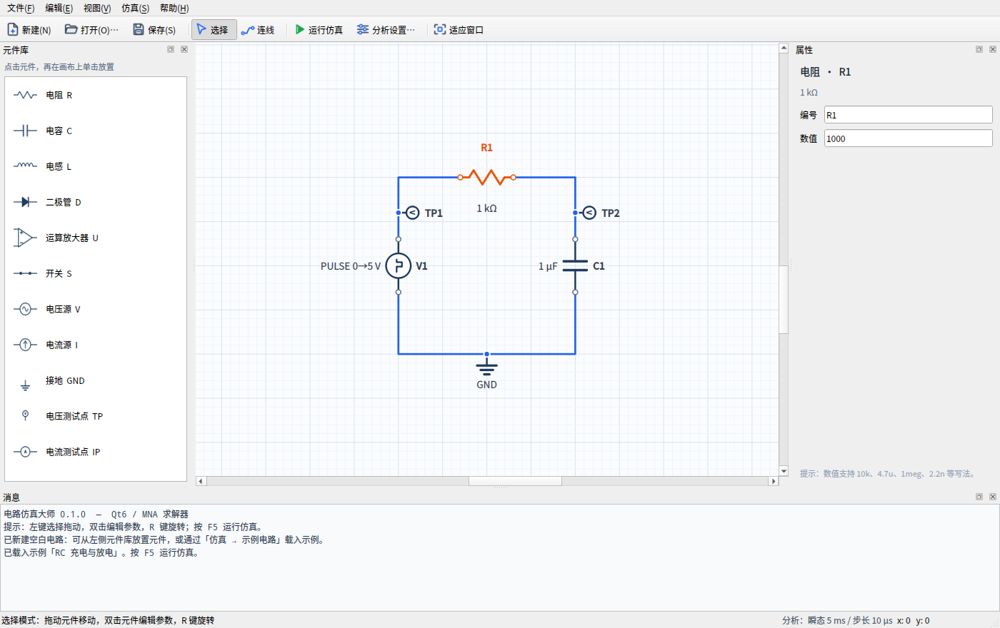
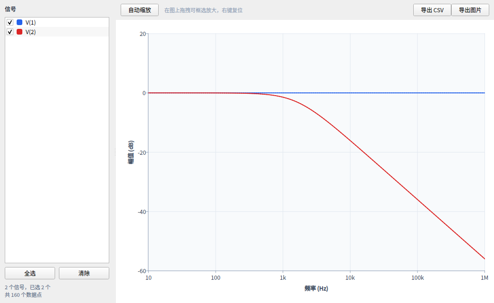

# 电路仿真大师（Circuit Master）

一款面向 Linux 的跨平台电路原理图编辑与仿真软件，使用 **Qt 6 + C++17 + CMake** 开发，
目标是提供 Multisim 的核心工作流替代方案：**画原理图 → 点运行 → 看波形**。


## 功能特性

**原理图编辑器**

- 网格画布、元件拖动吸附、旋转（R 键）、框选、删除
- 元件库：电阻、电容、电感、二极管、开关、电压/电流源、接地
- 折线导线绘制：端点自动吸附引脚，T 型连接与交叉点自动生成连接圆点
- 双击元件或选中后在右侧属性面板编辑参数，数值支持 `10k`、`4.7u`、`1meg`、`100nF` 等工程写法
- 内置 5 个可直接运行的示例电路

**仿真引擎（改进节点法 MNA）**

| 分析 | 说明 |
| --- | --- |
| 直流工作点 | 含二极管牛顿-拉夫逊迭代与 pnjlim 电压限幅 |
| 瞬态分析 | 后向欧拉积分，电容/电感伴随模型，结果含所有节点电压与元件电流 |
| 交流扫频 | 复数 MNA，十倍频扫频，输出幅频特性（dB），对数刻度波特图 |

**波形查看器**

- 多信号叠加，勾选式信号列表
- 框选缩放、自动缩放、时间轴自动切换 ns/µs/ms、工程记数法刻度
- 导出 CSV 数据、导出 PNG 图片

**文件与互操作**

- `.csm` 工程文件（JSON，可读、易扩展）
- 一键导出 SPICE 网表（`.cir`），可交给 ngspice 等外部工具复核
- 桌面集成：`.desktop` 文件与矢量图标，`cmake --install` 即可出现在应用菜单

### 界面截图

| 属性编辑 | 瞬态分析（RC 充电） |
| --- | --- |
|  |  |

| 交流扫频（RC 低通，-3 dB @ 1.59 kHz） | 二极管半波整流 |
| --- | --- |
|  |  |

## 快速开始

### 依赖

- CMake ≥ 3.21
- C++17 编译器（GCC 11+ / Clang 14+）
- Qt 6.5+：`Core`、`Gui`、`Widgets`、`Charts`、`Svg`，测试还需要 `Test`

Deepin / Debian / Ubuntu：

```bash
sudo apt install build-essential cmake qt6-base-dev qt6-charts-dev libqt6svg6-dev
```

### 构建与运行

```bash
cmake -S . -B build -DCMAKE_BUILD_TYPE=Release
cmake --build build -j"$(nproc)"
./build/CircuitMaster
```

### 安装到系统

```bash
sudo cmake --install build --prefix /usr/local
```

安装内容包括可执行文件、桌面入口与图标。之后可直接在应用菜单中搜索「电路仿真大师」。

### 运行测试

```bash
ctest --test-dir build --output-on-failure
```

- `core`：工程记数法解析、网表提取、分压/RC 充电/二极管整流/AC 低通数值正确性、JSON 往返、SPICE 导出
- `ui`：窗口渲染截图、属性编辑、旋转、鼠标绘制导线、从零搭建 RC 电路并仿真、交流分析截图

## 使用说明

1. **放置元件**：在左侧「元件库」点击元件，然后在画布上单击放置；按住 `Ctrl` 可连续放置。
2. **连线**：点击工具栏「连线」（或按 `W`），在引脚处单击，移动鼠标继续单击添加拐点，**双击或右键结束**；`Esc` 取消。
3. **编辑参数**：双击元件，或选中后在右侧属性面板修改编号与数值，回车生效。
4. **运行仿真**：按 `F5` 或点击「运行仿真」。波形在独立窗口中显示；工作点分析会弹出文字报告。
5. **分析设置**：菜单「仿真 → 分析设置」切换工作点 / 瞬态 / 交流，并设置时间、步长或扫频范围。

> 电路必须包含**接地符号（GND）**，否则无法确定参考节点，仿真会给出提示。

### 支持的元件

| 元件 | 参数 |
| --- | --- |
| 电阻 R | 阻值（Ω） |
| 电容 C | 容值（F），瞬态使用后向欧拉伴随模型 |
| 电感 L | 感值（H），以支路电流为未知量 |
| 二极管 D | 1N4148 简化模型（IS=2.52 nA，N=1.752） |
| 开关 S | 闭合 1 mΩ / 断开 1 GΩ |
| 电压源 V | DC / SIN / PULSE |
| 电流源 I | DC / SIN / PULSE |
| 接地 GND | 参考节点 0 |

## 项目结构

```
├── CMakeLists.txt
├── assets/icon.svg                 应用图标
├── packaging/circuit-master.desktop
├── src/
│   ├── core/                       数据模型与网表
│   │   ├── Component.{h,cpp}       元件定义、引脚几何、源波形
│   │   ├── Circuit.{h,cpp}         电路文档、JSON、SPICE 导出
│   │   ├── Netlist.{h,cpp}         引脚坐标并查集 → 节点编号
│   │   └── Units.{h,cpp}           工程记数法解析/格式化
│   ├── sim/
│   │   ├── Matrix.h                稠密 LU（实数 + 复数）
│   │   └── Simulator.{h,cpp}       MNA 装配、牛顿迭代、瞬态/交流
│   ├── ui/                         原理图编辑器与波形查看器
│   └── main.cpp
├── tests/                          test_core / test_ui
└── docs/architecture.md            求解器与实现细节
```

## 实现要点

- **连接关系**：把所有引脚与导线顶点映射到 10 px 网格并查集合并；引脚落在导线中间时视为 T 型连接。只有“导线端点落在导线上”或“引脚落在导线上”才产生连接点，十字交叉不会被误连。
- **求解器**：未知量为非地节点电压 + 电压源/电感支路电流；每个节点对地加 1 pS 的 gmin 以避免纯浮空节点导致矩阵奇异。
- **非线性**：二极管用牛顿迭代线性化，并采用 SPICE 的 pnjlim 限制每次迭代电压跳变。
- **瞬态**：电容伴随电导 `C/h` 与历史电流源，电感伴随电阻 `L/h` 与历史电压源；以直流工作点作为初始条件。

更详细的公式与矩阵结构见 [docs/architecture.md](docs/architecture.md)。

## 已知限制与路线图

当前版本是 **0.1.0**，聚焦于“可用且结果可信”的最小闭环。已知限制：

- 尚无撤销/重做、复制/粘贴；导线画出后不能拖动端点（需删除重画）
- 二极管模型未包含串联电阻、结电容；开关为理想电阻模型
- 瞬态为固定步长后向欧拉（一阶精度），暂不支持自适应步长与梯形法
- 稠密矩阵求解，建议元件规模在数百以内
- 交流分析输出幅值，暂未绘制相位曲线

计划：

- [ ] 撤销/重做、复制粘贴、导线端点拖动、对齐与自动布线
- [ ] 三极管 / MOSFET / 运放 / 受控源 / 变压器等元件
- [ ] 自适应步长瞬态、梯形法、SPICE `.model` 导入
- [ ] 交流相位、阻抗、傅里叶与参数扫描
- [ ] 子电路与层次化设计、BOM 与 PDF 出图

## 开发约定

提交信息遵循 [Conventional Commits](https://www.conventionalcommits.org/zh-hans/)：
`feat` / `fix` / `docs` / `refactor` / `perf` / `test` / `build` / `chore` 等，
格式为 `<type>(<scope>): <subject>`。详见 [docs/CONTRIBUTING.md](docs/CONTRIBUTING.md)。

仓库提供了提交模板，克隆后执行一次即可启用：

```bash
git config commit.template .gitmessage
```

## 许可

本项目为自由软件，可作为 Multisim 在 Linux 上的替代方案使用与修改。
如需用于商业分发，请自行确认所链接 Qt 模块的许可证（LGPL/GPL）要求。
