# 电路仿真大师（Circuit Master）

一款跨平台的电路原理图编辑与仿真软件（**Linux / Windows / macOS**），
使用 **Qt 6 + C++17 + CMake** 开发，目标是提供 Multisim 的核心工作流替代方案：
**画原理图 → 点运行 → 看波形**。Linux 侧提供 deb 与便携包，Windows 提供安装包与
便携 zip，macOS 提供 dmg。


## 功能特性

**原理图编辑器**

- 导线十字交叉默认不相连（不画交点）；要连接就在交叉点右键「在此处打交点」。
  自动合并只在**没有交点**时发生：拐角、一条线分两笔续画会并成一条；
  线头搭在直穿的线上、或三条以上线头汇聚则不并（否则交点会消失）
- 元件的标号 / 数值可以单独拖动摆放，位置随工程保存；旋转/翻转时自动还原，
  右键菜单里也能手动「还原标签位置」
- **深浅色主题**：「视图 → 主题」可选跟随系统 / 浅色 / 深色，选择随工程之外的
  用户配置保存；画布、符号、波形图表与对话框都有各自的深色配色，切换立即生效
- 网格画布、元件拖动吸附、旋转（空格键，逆时针 90°）、框选、删除；
  拖动元件时连在它引脚上的导线会跟着走；拖导线时两端保持在引脚上，导线被拉长/拉高；
  拖动后走线自动保持横平竖直（斜段会补成直角拐点）；也可以单独拖首尾端点主动改接
- **图纸与页面设置**：画布就是一张纸（A4 / A3 / A2 / A1 / 自定义，横向或纵向），
  空白处右键、「文件 → 页面设置」或 Ctrl+Shift+P 换纸张；工具栏「适应图纸」把整张纸铺满视图，网格只画在纸内、边界是双实线图框；新建默认 A4 横向，
  纸张随文件存进 `.csm`（示例各自带着自己那张纸：反激电源是 A3 横向）；
  「另存为」可选 PDF，页面尺寸跟着这张纸走，内容铺满整页
- **单实例**：再次双击 .csm 时不会开第二个窗口，而是在已有窗口里开新标签
- **多文件标签页**：一个标签一份电路，各自的画布、撤销历史与分析参数互不干扰；
  新建 / 打开 / 载入示例都开新标签，Ctrl+W 关闭、Ctrl+Tab 切换
- 撤销 / 重做（Ctrl+Z / Ctrl+Shift+Z），覆盖放置、移动、删除、粘贴与参数修改
- 框选后可整体拖动（元件与导线一起移动，连接关系保持不变）
- **仿真时点开关就通断**：实时仿真运行中，左键点一下开关即断开 / 闭合，
  仿真原地换上新拓扑（波形不中断）；没跑仿真时点击仍是选中 / 拖动。
  **按钮开关**则是按住才动作、松手复位（常开 / 常闭可选），适合做上电复位、
  手动触发这类操作
- 元件右键菜单：旋转 90°、水平翻转、垂直翻转、剪切/复制/粘贴（Ctrl+X / Ctrl+C / Ctrl+V）、编辑属性、删除
- 对齐与分布（编辑菜单 / 右键菜单）：左 / 水平居中 / 右 / 顶 / 垂直居中 / 底对齐，水平等距 / 垂直等距
- 「编辑」菜单里也有剪切 / 复制 / 粘贴，按选中状态与剪贴板自动启用；
  粘贴的内容落在鼠标当前位置（多个元件时以整块中心对准光标）
- 元件库：顶部下拉框按「基础 / 半导体 / 模拟 IC / 数字逻辑 / 电源 / 开关与接地 / 测量」
  分类筛选，拖到画布上放置；每个条目按**自己那一种**图形画图标（五种门、五种接地
  各有各的样子）
- 参考节点的选取顺序：**GND → 任意一种地（AGND / DGND / PGND / EARTH）→ 万用表负端**。
  「五种地相互隔离」说的是它们各自成网，不影响参考点怎么定；没有 GND 时会用第一个
  当地，消息区会写明用了哪个。**有万用表时连地都可以省掉**（此时波形监控不可用，
  只能看万用表读数）
- 折线导线绘制：端点自动吸附引脚，T 型连接与交叉点自动生成连接圆点
- 双击元件或选中后在右侧属性面板编辑参数，数值可直接带单位：`10kΩ`、`4.7µF`、`10mH`、`5V`、`1mA`；
  不写单位时按元件默认单位（Ω/F/H/V/A）
- 内置 8 个可直接运行的示例电路（位于 `resources/examples`，可直接编辑）

**仿真引擎（改进节点法 MNA）**

| 分析 | 说明 |
| --- | --- |
| 直流工作点 | 含二极管牛顿-拉夫逊迭代与 pnjlim 电压限幅 |
| 瞬态分析 | 后向欧拉积分，电容/电感伴随模型，结果含所有节点电压与元件电流 |
| 交流扫频 | 复数 MNA，十倍频扫频，输出幅频特性（dB），对数刻度波特图 |

**实时示波器**

- 与静态波形共用同一白色界面，连续仿真、滚动显示，不需要“停止时间”
- 步长自动推导：按**脉宽**约束（高电平至少 4 个采样点）与「每个电源周期 20 点」取较小值，
  不再看脉冲边沿有多陡 —— 按边沿算的话，1 µs 的沿会把步长压到 200 ns，
  5 s 的窗口要 2500 万步，一秒只能推进 0.1 s
- 首次运行等波形展开后按峰值自动选一次「电压/格」「电流/格」「时间/格」；
  之后**手动改过的量程会锁定**，不再被自动改掉 —— 需要重新自适应就点「自动缩放」
- 6×10 网格，时间轴固定为 0–时间窗，波形在其中滚动；左下角显示当前时间与“时间/格”
- 时间/格 5 ns/div–100 s/div（总窗口 = 10 格），支持暂停 / 继续 / 停止
- 关闭窗口或点「停止」即结束实时仿真
- 电压与电流分别使用左右 Y 轴
- 「波形监控」是独立窗口，两个标签页：静态波形（曲线与导出）和动态示波器（连续滚动）；
  运行仿真不会自动弹窗，点「波形监控」才打开，关掉窗口仿真仍在后台继续；
  分析参数（分析类型、停止时间、最大步长、扫频范围）就在静态波形页里，改完点「重新仿真」

**检查更新**

- 「关于」窗口里的「更新日志」按钮：`CHANGELOG.md` 编进程序，离线也能看每个版本改了什么
- 菜单「帮助 → 检查更新…」手动检查，或启动 3 秒后自动检查一次（只在新版本出现时弹窗）
- 数据来源是随 Release 上传的 `latest.json`，按「下载安装包」的实测速度依次尝试
  v4.gh-proxy.org / ghfast.top / gh-proxy.org / cdn.gh-proxy.org 几个镜像，
  首条请求 700 ms 未返回就并行补发一条，避免单条连接卡住；
  下载时若某个镜像 10 s 不来数据、或 8 s 还不到 200 KB，自动换下一个地址
- **下载界面显示当前地址与实时速度**（已下载 / 总量 / 剩余时间），地址可选中复制
- **一键下载并安装**：清单里带资产列表，包的类型自动选，下到临时目录后直接拉起安装程序：
  - 平台来自编译期枚举（Linux / Windows），架构也是（amd64 / arm64 / loong64 / riscv64）
  - 安装方式在运行时判断 —— **deb 装的给 deb，便携拆包运行就给 tar.gz**；
    Windows 同理（Inno 安装版给 setup.exe，解压版给 zip），另一种形态作为退路
  - 判断依据：Windows 看安装目录有没有 `unins*.exe`，Linux 看可执行文件是否在 `/usr` 等下；
    环境变量 `CSM_INSTALL_KIND=system|portable` 可强制覆盖
- 下载通路与查版本一致：先用**刚才取清单成功的那条镜像**，再依次试其它镜像，
  最后才直连 GitHub；失败自动换下一条重试
- 安装方式：Windows 拉起 `setup.exe`；deb 走 `pkexec dpkg -i`（弹一次授权框），装完删除安装包；
  便携包无法自动覆盖正在运行的程序，改为打开所在文件夹让你自己解压
- 安装程序跑完后安装包可能还被占用，删不掉就记下来，下次启动时补删
- 清单里的发布页地址只认本仓库，防止被篡改的清单带偏
- 设置环境变量 `CSM_NO_UPDATE_CHECK=1` 可关闭启动检查（测试即用此方式）

**测试点与波形**

- 电压测试点 TP：单端探针，测量所在节点电压
- 电流测试点 IP：二端探针，串联 0 V 源测量支路电流
- 网络标签 NET：单引脚，只有网络名、没有编号；同名标签在网表里并成一个网络，
  不用拉线也能把画布两处的网络连起来（报告里的节点名也用标签名显示）
- 万用表 XMM：五档位二端仪器 —— 直流电压档并联（10 MΩ 内阻）、直流电流档串联、
  电阻档注入 1 A 测试电流直接读出欧姆数、**交流电压档 / 交流电流档按一个 50 Hz
  周期算有效值**；档位在属性面板切换，**实时仿真运行中**点击万用表弹出七段码读数窗口（停止后自动关闭）
- **测量探针 MP**：拖到导线上就显示淡黄读数框（参照 Multisim 的探头）——
  电压的峰峰值 / 有效值 / 直流，加上该段电流的同样三项，能估出周期时再补一行频率。
  箭头沿导线指向，电流沿箭头为正、反向为负，把探针转 180° 即可翻转符号；
  实时仿真运行时读数跟着刷新。黄框就是这个元件本身的样子，元件库里也是它
- 波形页只列测试点（TP / IP）—— 万用表的读数走它自己的七段码窗口，不混进时域曲线
- 未放置测试点时波形为空
- 电压/电流同时显示时自动启用左右双 Y 轴，并按 mV/mA/µA 自动缩放
- 框选缩放、自动缩放、时间轴自动切换 ns/µs/ms、工程记数法刻度
- 导出 CSV 数据、导出 PNG 图片

**自动保存与崩溃恢复**

两个开关各自独立，都在「编辑 → 设置 → 保存」里：

- **自动保存**（默认 10 分钟，可设 1–120）：把未保存的更改**直接写回电路自己的
  `.csm`**，等价于按一次保存 —— 标题上的 `*` 随之消失，消息区记一行
  「已自动保存 N 份电路」。未命名的图纸没有文件可写，跳过。
- **崩溃恢复**（默认 2 分钟，可设 1–60）：按自己的间隔把「改过但还没保存」的图纸
  另存一份副本，覆盖未命名图纸，以及两次保存之间改动的内容 —— 所以自动保存设得
  再疏，崩溃最多也只丢这么一会儿。程序被强杀或崩溃后，下次启动会列出这些副本
  （文件名 + 时间）并询问是否恢复；关掉这个开关则不再询问，残留副本直接丢弃。
- 副本放在 `~/.local/share/CircuitMaster/Circuit Master/recovery/`（Windows 在
  `%APPDATA%`、macOS 在 `Application Support` 下），一份图纸一个 JSON。
- 手动保存会删掉对应副本；正常退出时整批清空 —— 目录为空就说明没有遗留内容。

**文件与互操作**

- `.csm` 工程文件（JSON，可读、易扩展；可携带分析类型与参数）
- 桌面集成：`.desktop` 文件与矢量图标，`cmake --install` 即可出现在应用菜单

### 界面截图

| 属性编辑 | 瞬态分析（RC 充电） |
| --- | --- |
|  |  |

| 交流扫频（RC 低通，-3 dB @ 1.59 kHz） | 二极管半波整流 |
| --- | --- |
|  | 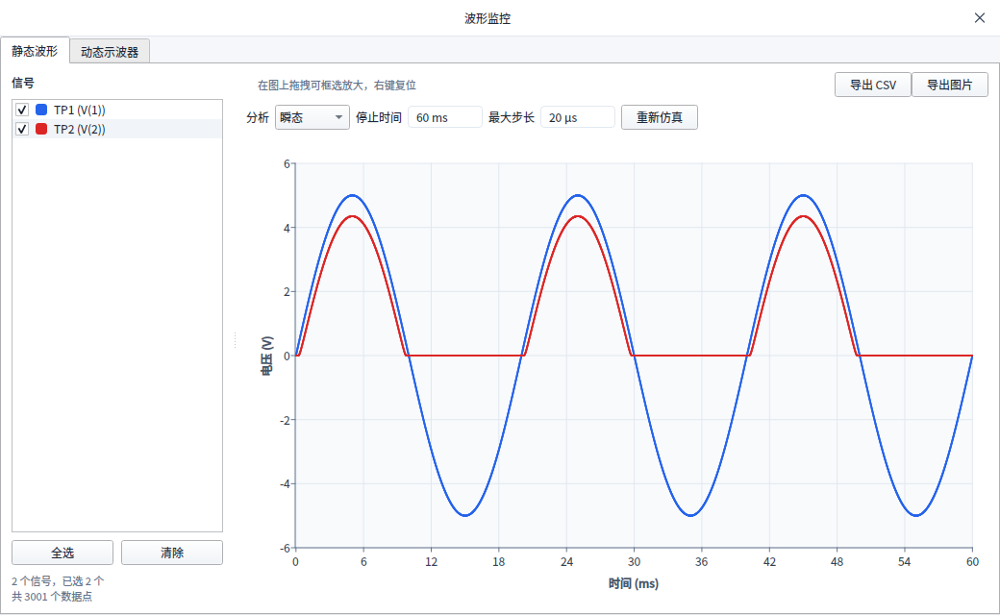 |

| 运放反相放大器（R2/R1 = 10） | 输出波形（反相 10 倍） |
| --- | --- |
| 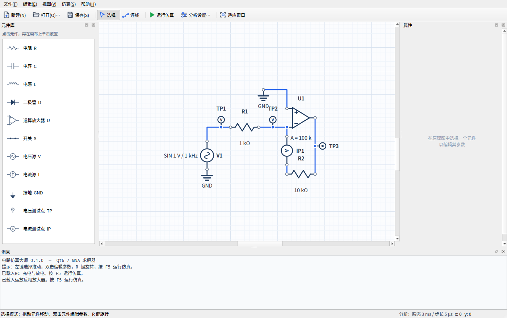 | 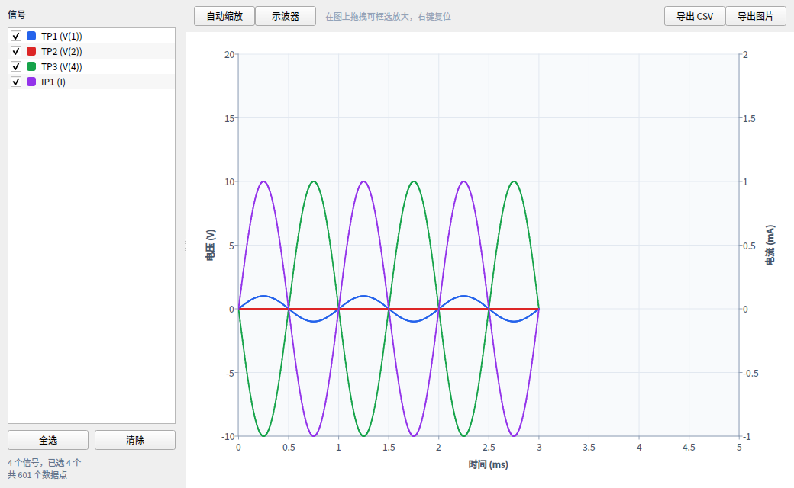 |

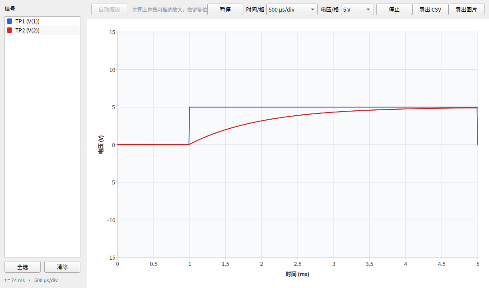


从便携包运行时会自动选择便携包下载：

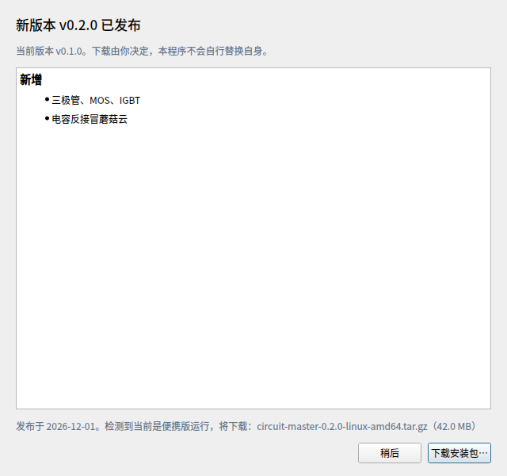

内置示例「TL431 可调稳压（5 V）」：

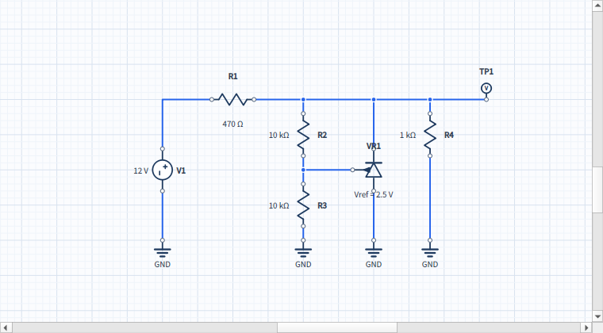

OB2362 电流模式 PWM 控制器：

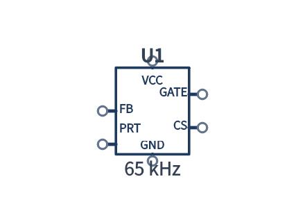

五种接地符号（同一个「接地」元件，属性里切换）：


示例「220 V 转 12 V 反激电源（OB2362）」：220 V **有效值**经桥式整流得到约 310 V 母线，
OB2362 以 65 kHz 峰值电流模式驱动 MOSFET，经反激变压器与 470 µF 滤波输出 12 V；
TL431 + 光耦构成闭环反馈（R8/R9 分压到 2.495 V，即 12.0 V），RCD 缓冲、辅助绕组供电都在里面：

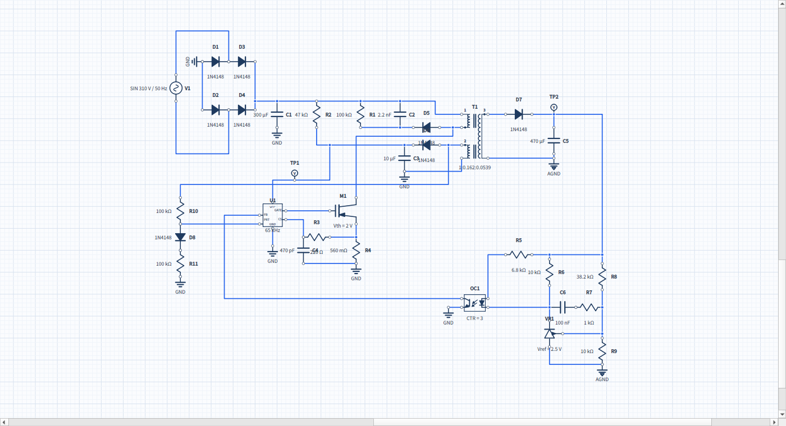

变压器（左为初级「1」，右为次级「2」，圆点标同名端；旋转/翻转后数字仍正着写）：

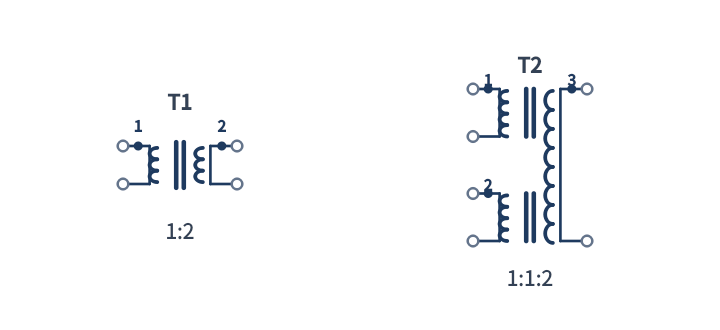

三绕组时每个绕组各有匝数比，标注形如 `1:1:2`（初级 : 辅助 : 次级）：

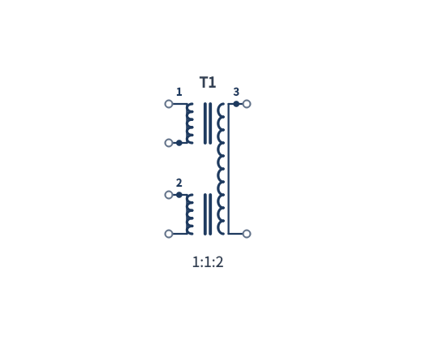

同名端可切换：反相时次级圆点画在下方，次级电压反 180°：

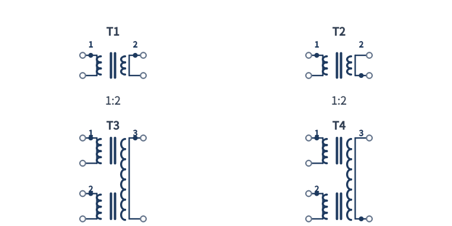

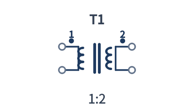

TL431 可调基准（REF / 阳极 / 阴极）：


光耦（四引脚：输入 LED 阳极/阴极、输出集电极/发射极）：

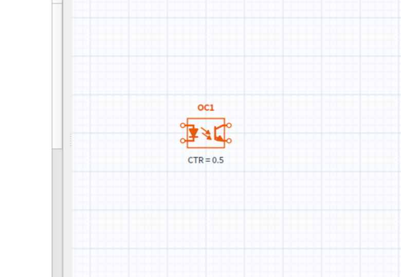

五种三端器件（NPN / PNP / N 沟道 MOS / P 沟道 MOS / IGBT）：

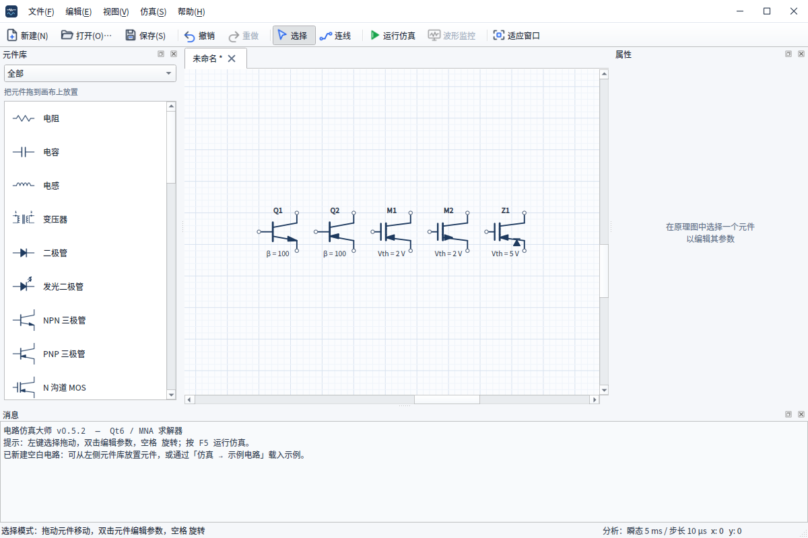

恒定信号（纯直流电路）也会给出可读的纵轴刻度：

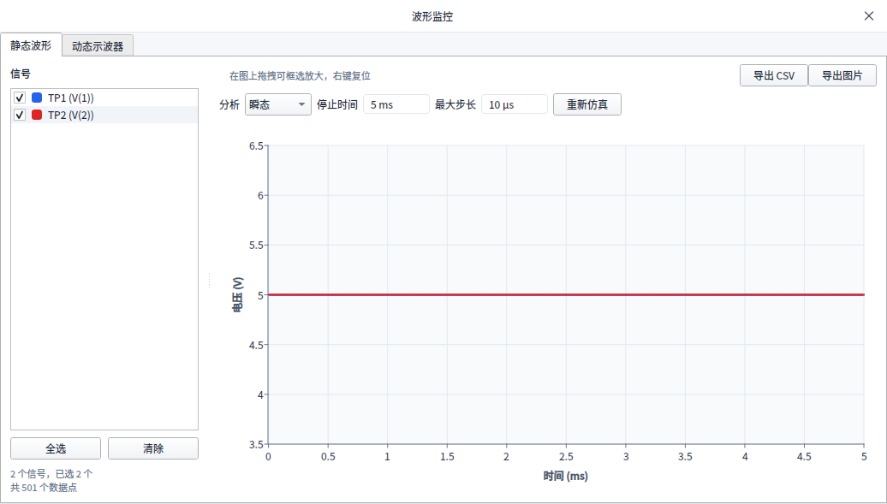

波形监控窗口（静态波形 / 动态示波器，分析参数在静态页里）：


拖动元件或导线后，走线都保持横平竖直（端点连着引脚，斜段自动补成直角拐点）：

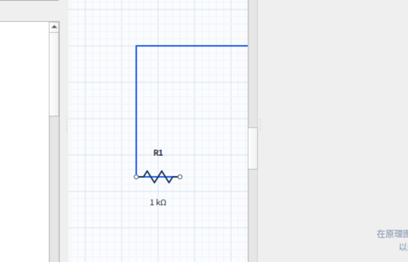

电容默认无极性，勾选「有极性」后按电解电容绘制（直板 + 弯板 + 「+」）：


电解电容反接：先烧红（红温），再炸成蘑菇云，特效保留到仿真结束。

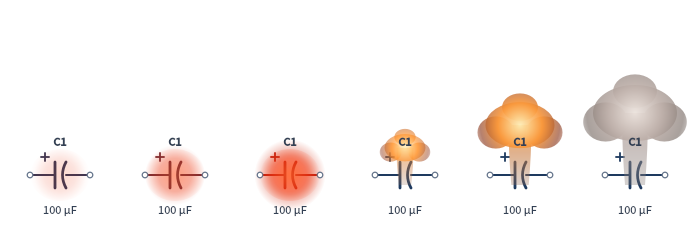

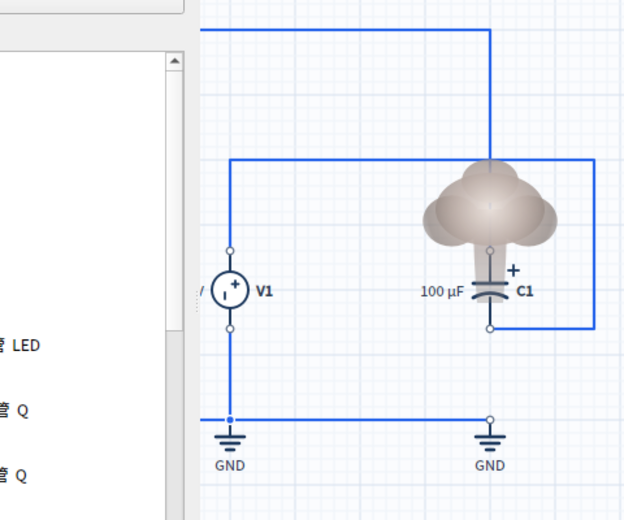

发光二极管会按正向电流点亮（3 mA 时）：

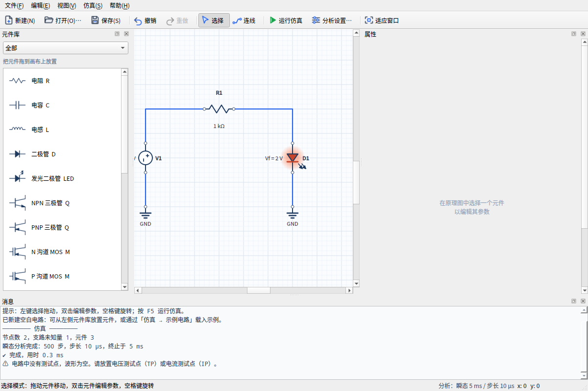

## 快速开始

### 依赖

- CMake ≥ 3.21
- C++17 编译器（GCC 11+ / Clang 14+）
- Qt 6.5+：`Core`、`Gui`、`Widgets`、`Charts`、`Svg`、`Network`（单实例转发用本地套接字），
  测试还需要 `Test`

Deepin / Debian / Ubuntu：

```bash
sudo apt install build-essential cmake qt6-base-dev qt6-charts-dev libqt6svg6-dev
```

macOS（Homebrew）：

```bash
brew install qt cmake ninja
cmake -S . -B build -G Ninja -DCMAKE_PREFIX_PATH="$(brew --prefix qt)"
cmake --build build
open build/CircuitMaster.app
```

### 构建与运行

```bash
cmake -S . -B build -DCMAKE_BUILD_TYPE=Release
cmake --build build -j"$(nproc)"
./build/CircuitMaster
```

### 安装到系统

```bash
sudo cmake --install build --prefix /usr/local
```

安装内容包括可执行文件、桌面入口与图标。之后可直接在应用菜单中搜索「电路仿真大师」。

> 桌面入口由 `resources/linux/circuit-master.desktop.in` 在配置阶段生成，`Exec` 取自
> `CMAKE_INSTALL_FULL_BINDIR`。若修改安装前缀，请重新运行一次 `cmake -S . -B build`
> 让路径同步。

### 运行测试

```bash
ctest --test-dir build --output-on-failure
```

一共 9 个测试二进制，一个文件一个可执行文件：

- `test_core_analysis`：网表提取、分压 / RC 充电 / 二极管整流 / AC 低通 / 逻辑门真值表等数值正确性
- `test_core_device`：二极管、三极管、MOS、光耦、TL431、OB2362、变压器等器件模型
- `test_core_model`：数据模型、工程记数法解析、JSON 往返
- `test_core_update`：版本比较、更新清单解析、镜像排序
- `test_ui_editor`：画布编辑、旋转 / 翻转、导线、对齐与分布、引脚吸附网格
- `test_ui_panel`：属性面板、元件库分类与图标
- `test_ui_meter`：万用表读数窗口与七段码显示
- `test_ui_waveform`：波形监控、自动量程、静态 / 动态示波器
- `test_ui_workflow`：整体流程、检查更新、多标签页、单实例、截图核对

## 使用说明

启动后是空白电路。想快速体验可先打开「仿真 → 示例电路」中的任意示例。

1. **放置元件**：从左侧「元件库」把元件拖到画布上放置。
2. **连线**：点击工具栏「连线」（或按 `W`），在引脚处单击，移动鼠标继续单击添加拐点，**双击或右键结束**；`Esc` 取消。
3. **编辑参数**：双击元件，或右键选择「编辑参数…」，在右侧属性面板修改编号与数值，回车生效。
   误操作可用 `Ctrl+Z` 撤销、`Ctrl+Shift+Z` 重做。
   右键还可以旋转、水平/垂直翻转、复制粘贴元件。
4. **放置测量点**：从元件库选择「电压测试点 TP」「电流测试点 IP」「测量探针 MP」
   或「万用表 XMM」，放在要观察的节点/支路/导线上；万用表的档位、探针的读数都在
   右侧属性面板与画布上的读数框里。
5. **运行仿真**：按 `F5` 或点击「运行仿真」。运行只做计算，不会自动弹窗口；
   要看曲线点「静态波形」，要连续观察点「动态示波器」。
   波形只显示测试点信号，没有测试点时为空；工作点分析会弹出文字报告。
6. **分析参数**：在「波形监控 → 静态波形」页顶部切换工作点 / 瞬态 / 交流扫频，
   设置停止时间、最大步长或扫频范围，点「重新仿真」生效。
   要看连续滚动的波形就切到「动态示波器」页，按「停止仿真」结束。
   这些设置会随 `.csm` 一起保存，重新打开时自动恢复。

> 参考节点按 **GND → 任意一种地 → 万用表负端** 的顺序自动选取；三者都没有时才会
> 提示「无法确定参考节点」。没有 GND 的电路不给开波形监控（节点电压之间没有统一基准），
> 万用表读数不受影响。

### 支持的元件

| 元件 | 参数 |
| --- | --- |
| 电阻 R | 阻值（Ω） |
| 电容 C | 容值（F），瞬态使用后向欧拉伴随模型；默认无极性，可勾选「有极性」按电解电容绘制。反接超 1 V 会「炸」——原理图上冒蘑菇云（保留到仿真结束）并写日志 |
| 电感 L | 感值（H），以支路电流为未知量 |
| 二极管 D | PN 结指数模型（N=1.752），正向压降可调（默认 0.7 V，按 20 mA 时的压降标定） |
| 稳压二极管 DZ | 正向同二极管（压降可调），反向在击穿电压 Vz（默认 5.1 V）处导通稳压 |
| 发光二极管 LED | 与二极管同方程，由正向压降反推模型；参数：Vf（默认 2 V）。仿真后按正向电流点亮，电流越大越亮 |
| 三极管 Q | NPN / PNP，Ebers-Moll 模型；参数：电流放大系数 β（默认 100） |
| MOS 管 M | N / P 沟道增强型，level-1 平方律模型；参数：开启电压 Vth、跨导参数 K |
| 光耦 OC | 输入侧红外 LED + 输出侧光敏三极管。默认参数按 **LTV-817S-TA1-C**：Vf = 1.2 V、CTR = 3.0（C 档 200–400%）、Vce(sat) = 0.2 V。输出特性带饱和：`Ic = CTR·If·x/(1+x)`，`x = Vce/Vce(sat)`，因此发射极不会被顶到集电极之上 |
| 接地 GND | 元件库只有一个「接地」，在属性面板「接地种类」里切换 **GND / AGND / DGND / PGND / EARTH**。五种地**相互隔离**：同种地自动并成一个网络，非主地只通过 1 MΩ 漏电阻接主地（相当于断路），要连起来就在画布上拉一根线 |
| OB2362 控制器 U | 昂宝 OB2362A 电流模式 PWM 控制器（SOT23-6：VCC / GND / FB / PRT / CS / GATE）。行为级模型：内部 65 kHz 振荡器，GATE 按 FB 决定的 CS 目标值逐周期关断，CS 达阈值即限流，VCC < 7.3 V 欠压关断 |
| 变压器 T | 绕组形式可选**单绕组**（4 引脚：初级 + 次级）或**初级 + 辅助绕组 + 次级**（6 引脚）；参数为初级电感 L1、匝数比 N1:N2:N3（单绕组为 N1:N2）与次级同名端（正接 / 反相）；绕组旁标「1」「2」「3」与同名端圆点 |
| TL431 基准 VR | 三端可调基准：REF 高于基准电压（默认 2.495 V）时阴极开始吸电流，把 Vka 稳在设定值；REF 接阴极即 2.5 V 基准，配分压电阻可做可调稳压 |
| IGBT Z | 栅极按 MOS 模型、输出侧带导通压降 Vf；参数：Vth、K、Vf |
| 运算放大器 U | 三端运放。可调开环增益（默认 100 k）、输出上限 / 下限（±15 V）、增益带宽积（1 MHz）、压摆率（0.5 V/µs）、输入失调、输入偏置电流、输入电阻（2 MΩ，每个输入端对地）、输出电阻（50 Ω） |
| 逻辑门 AND / OR / NOT / XOR / XNOR | 数字门，在元件库「数字逻辑」分类下。输入高阻，输出按「电平 + 100 Ω 内阻」等效，因此能直接驱动 LED / MOS / 三极管；参数只有输出高电平（默认 3.3 V），低电平固定 0 V，输入阈值取高电平的一半并带 5% 回差 |
| 电压测试点 TP | 单引脚探针，读取节点电压，不参与矩阵求解 |
| 电流测试点 IP | 二引脚探针，以 0 V 电压源串入支路，读取该支路电流 |
| 测量探针 MP | 单引脚，放在导线上自动出现淡黄读数框：该处的电压峰峰值 / 有效值 / 直流、该段电流的同样三项，以及频率。电流按「在探针处切开导线、对这一侧做 KCL 求和」算 —— 一根线中途有 T 型分支时，分支前后的电流本来就不同 |
| 网络标签 NET | 单引脚标记，同名标签在网表里并成一个网络，不用画线 |
| 万用表 XMM | 二引脚仪器，五档位：直流电压档 10 MΩ 并联、直流电流档串联、电阻档注入 1 A 读 V/I、交流电压档 / 交流电流档按 50 Hz 一个周期算有效值 |
| 开关 S | 闭合 1 mΩ / 断开 1 GΩ |
| 按钮开关 SB | 瞬时按钮，接触电阻与开关相同。**仿真时按住才动作、松手复位**；常开（按住接通）/ 常闭（按住断开）在属性面板切换 |
| 电压源 V | DC / SIN / PULSE |
| 电流源 I | DC / SIN / PULSE |
| 信号发生器 FG | 两端元件，直接参与仿真。波形：**正弦 / 方波（占空比可调）/ 三角波 / 锯齿波**；参数为峰值幅值、频率、相位与直流偏置。符号画成圆角矩形「仪器机身」，与圆圈形的电压源一眼分开 |

粘贴时整块内容按 10 px 整数倍平移，形状不会被改；早期版本粘歪的图可以用
「编辑 → 导线对齐网格」修回来。

所有元件的引脚坐标都是 10 px 的整数倍，放在网格上就能接线（有测试守着）。

## 项目结构

```
├── CMakeLists.txt
├── resources/
│   ├── assets/
│   │   ├── circuit-master.qrc      资源清单（/icons 图标、/docs 内置更新日志）
│   │   └── icons/                  应用图标 + 18 个界面图标（工具栏、标签页关闭）
│   ├── examples/                   内置示例（.csm + examples.qrc）
│   ├── linux/circuit-master.desktop.in   桌面入口模板（CMake 生成）
│   ├── mac/circuit-master.icns     macOS 应用图标
│   └── win/                        Windows 资源
│       ├── circuit-master.ico      exe 图标 / 安装程序图标（由 SVG 生成）
│       ├── circuit-master.rc       PE 资源段（资源管理器里的 exe 图标）
│       ├── circuit-master.iss      Inno Setup 安装脚本
│       └── ChineseSimplified.isl   Inno Setup 简体中文语言包
├── scripts/
│   └── package-linux-tarball.sh    从 .deb 生成便携 tar.gz
├── src/
│   ├── core/                       数据模型与网表
│   │   ├── Component.{h,cpp}       元件定义、引脚几何、源波形
│   │   ├── Circuit.{h,cpp}         电路文档、JSON 存盘
│   │   ├── Netlist.{h,cpp}         引脚坐标并查集 → 节点编号
│   │   └── Units.{h,cpp}           工程记数法解析/格式化
│   ├── sim/
│   │   ├── Matrix.h                稠密 LU（实数 + 复数）
│   │   └── Simulator.{h,cpp}       MNA 装配、牛顿迭代、瞬态/交流
│   ├── ui/                         原理图编辑器与波形查看器
│   └── main.cpp
├── tests/                          单元测试：一个文件 = 一个可执行文件，
│                                  每个文件自成一体（辅助函数也各留一份）
│   ├── test_core_*.cpp             分析 / 器件 / 数据模型 / 更新检查（4 个）
│   └── test_ui_*.cpp               画布编辑 / 面板 / 万用表 / 波形 / 工作流（5 个）
└── docs/architecture.md            求解器与实现细节
```

## 实现要点

- **导线合并**：只在**画线时**发生 —— 新画的一段与已有导线首尾相接时并成一条：
  共线就直接续上，只是拐角相接也会并成一条折线（文件里就是一条线）；
  有支路接入时只并共线的那一对，支路保持独立。连接点上的「穿透」导线会先被切开，
  再把共线的两段接成一条 —— 所以无论从哪头画起，存盘时直通的线都是一条。
  拖动导线或端点后也会做一次同样的整理，所以拖到与另一根共线相接时会并成一条。
  已经存在工程里的独立导线在打开时不会被改写。
- **点选高亮**：点导线时只把点到的那一段画成高亮色，整条多段线其余部分保持原色。
- **连接关系**：把所有引脚与导线顶点映射到 10 px 网格并查集合并；引脚落在导线中间时视为 T 型连接。只有“导线端点落在导线上”或“引脚落在导线上”才产生连接点，十字交叉不会被误连。
- **求解器**：未知量为非地节点电压 + 电压源/电感支路电流；每个节点对地加 1 pS 的 gmin 以避免纯浮空节点导致矩阵奇异。
- **非线性**：二极管用牛顿迭代线性化，并采用 SPICE 的 pnjlim 限制每次迭代电压跳变。
- **瞬态**：电容伴随电导 `C/h` 与历史电流源，电感伴随电阻 `L/h` 与历史电压源；以直流工作点作为初始条件。

更详细的公式与矩阵结构见 [docs/architecture.md](docs/architecture.md)。

## 已知限制与路线图

当前版本是 **0.6.0**，聚焦于“可用且结果可信”的最小闭环。已知限制：

- 导线中间拐点不能单独拖动（只能拖首尾端点，或拖动导线主体让它变形）
- 二极管模型未包含串联电阻、结电容；开关为理想电阻模型
- 瞬态为固定步长后向欧拉（一阶精度），暂不支持自适应步长与梯形法
- 稠密矩阵求解，建议元件规模在数百以内
- 交流分析输出幅值，暂未绘制相位曲线

计划：

- [ ] 导线拐点拖动、自动布线
- [x] 对齐与分布
- [x] 变压器、逻辑门、万用表、网络标签、测试点、测量探针、信号发生器
- [x] 运放饱和、增益带宽积、压摆率、输入失调、偏置电流、输入 / 输出电阻
- [ ] 受控源（VCVS / VCCS / CCVS / CCCS）、IGBT 开关特性、运放共模输入范围
- [ ] 自适应步长瞬态、梯形法、SPICE `.model` 导入
- [ ] 交流相位、阻抗、傅里叶与参数扫描
- [x] PDF 出图（按图纸尺寸）
- [ ] 子电路与层次化设计、BOM

## 版本号

版本号只有一个来源：仓库根目录的 `VERSION` 文件（写法与 git tag 一致，如 `v0.5.2`）。

- CMake 在配置阶段读取它，剥掉 `v` 前缀后交给 `project(VERSION ...)`，
  并生成 `csm_version.h`（`CSM_VERSION_STRING` / `CSM_VERSION_NUMBER`）供源码使用
- 界面标题栏、消息区、关于对话框与 `--version` 输出都取自该宏，源码里不再硬编码版本号
- `VERSION` 已登记为 CMake 重配置依赖，改完直接构建即可生效
- 发版时同步更新 `CHANGELOG.md` 与 `debian/changelog`

```bash
./build/CircuitMaster --version
# 电路仿真大师 v0.5.2
```

## 持续集成

`.github/workflows/` 下有三个工作流（参考 drawio-qt 的结构）：

| 工作流 | 触发 | 内容 |
| --- | --- | --- |
| `build.yaml` | push / PR | **Linux**（Ubuntu 26.04）、**macOS**（Homebrew Qt）、**Windows**（MSYS2 UCRT64 / MinGW）三平台编译，校验 Qt ≥ 6.5、QtCharts 可用、产物存在（Windows 还检查 PE 子系统为 GUI，macOS 检查 `.app` 里的可执行文件） |
| `test.yaml` | push / PR | 三平台跑 `ctest`（`QT_QPA_PLATFORM=offscreen`），失败时自动 `--rerun-failed -V` 重跑并上传日志 |
| `release.yaml` | 任意分支 / tag | **Linux 四架构**（amd64 / arm64 / loong64 / riscv64，Deepin crimson 容器 + QEMU）`debuild` 出 `.deb` + 便携 `tar.gz`；**Windows 两架构**（x64 / arm64）`windeployqt` 打便携 zip 与 Inno Setup 安装包；**macOS 两架构**（`macos-26` → arm64、`macos-26-intel` → x64）用 `macdeployqt` 打包后 `hdiutil` 出 `.dmg`；随后生成校验和并发布 Release |

发版流程：

```bash
# 1. 改版本号（VERSION 与 debian/changelog 必须一致，CMake 会校验）
echo "v0.5.2" > VERSION
dch -v 0.5.2    # 或手工编辑 debian/changelog
# 2. 在 CHANGELOG.md 写一节 "## [v0.5.2]"，Release 正文直接取这一节
# 3. 打 tag 触发发布
git tag v0.5.2 && git push origin v0.5.2
```

> 未打 tag 的推送会生成 `continuous_build` 预发布，便于随时下载最新构建。

正式版（打 tag）还会额外发布一个 `latest.json` 更新清单，客户端直接读它判断版本，
不必先连 github.com 的 API：

```
https://github.com/<owner>/<repo>/releases/latest/download/latest.json
```

内容包含 `version`、`tag`、`name`、`page`、`notes`（与 Release 正文同源）与 `published_at`。
预发布不生成该文件（`/releases/latest` 本身就跳过预发布）。

## 打包（Debian / Ubuntu / Deepin）

安装包在 **Debian 12** 里构建（glibc 2.36、Qt 6.4），可装到 Debian 12/13、
Ubuntu 24.04+、Linux Mint 22、Kali 等大多数 Debian 系发行版；
龙芯与 riscv64 用 Deepin 镜像构建。`Depends` 由 `dpkg-shlibdeps` 按实际链接的库
自动生成，平台插件与翻译包放在 `Recommends`，避免包名差异卡住安装。


仓库内已包含 `debian/` 打包文件，可直接用 dpkg 工具链构建 `.deb`：

```bash
# 构建依赖：debhelper、cmake、Qt6 开发包
sudo apt install debhelper cmake qt6-base-dev qt6-charts-dev qt6-svg-dev

# 生成安装包（产物在上一级目录）
dpkg-buildpackage -us -uc -b
```

打包相关约定：

- 版本号：`debian/changelog` 是安装包的版本来源（dpkg 的硬约束），
  与根目录 `VERSION` 不一致时 CMake 会给出警告，发版请用 `dch -v 0.5.2` 同步
- 打包时传入 `-DCSM_BUILD_TESTS=OFF` 跳过单元测试（测试需要 Qt6::Test，与安装内容无关）
- 安装内容全部由 CMake 的 install 规则提供：可执行文件、`.desktop`、SVG 图标、示例电路

Windows 侧产物：

- 便携 zip：解压即用，`windeployqt` 已带齐 Qt 运行库与插件（含 `iconengines`，否则 SVG 图标不显示）
- 安装包 `*-setup.exe`：Inno Setup 6.5+ 编译，默认按用户安装（不弹 UAC），
  中文界面取自 `resources/win/ChineseSimplified.isl`

便携 tar.gz 由 `scripts/package-linux-tarball.sh` 从 `.deb` 生成，
内含启动脚本（设置 `LD_LIBRARY_PATH` / `QT_PLUGIN_PATH`）、Qt 运行库、插件与内置示例：

```bash
scripts/package-linux-tarball.sh --arch amd64 --from-deb ../circuit-master_0.5.2_amd64.deb
```

安装后的文件布局：

```
/usr/bin/CircuitMaster
/usr/share/applications/circuit-master.desktop
/usr/share/icons/hicolor/scalable/apps/circuit-master.svg
/usr/share/circuit-master/examples/*.csm
/usr/share/doc/circuit-master/          README、CHANGELOG、架构说明
```

## 开发约定

界面文案一律写英文（`CSM_TR("Open File")`），中文放在
`resources/translations/circuit-master_zh_CN.ts`；改了文案跑
`python3 scripts/update-translations.py`（或 `update_translations` 目标），
`--check` 只查漏翻。

更新日志有中英两份：`CHANGELOG.md` 与 `CHANGELOG.en.md`。**新改动一律写在
`## [未发布]` 下面** —— 已发布版本的段落发过 tag 之后就不该再动。这条靠人眼
很容易出错（项目里已经踩过三次），所以做成了检查：

```bash
python3 scripts/check-changelog.py          # 或 cmake --build build --target check_changelog
```

它拿每个 `## [vX.Y.Z]` 段落与同名 git tag 里那一版逐字比对，直接指出哪一行
被改动了。


提交信息遵循 [Conventional Commits](https://www.conventionalcommits.org/zh-hans/)：
`feat` / `fix` / `docs` / `refactor` / `perf` / `test` / `build` / `chore` 等，
格式为 `<type>(<scope>): <subject>`。详见 [docs/CONTRIBUTING.md](docs/CONTRIBUTING.md)。

仓库提供了提交模板，克隆后执行一次即可启用：

```bash
git config commit.template .gitmessage
```

## 许可

本项目以 **GNU 通用公共许可证第 3 版或更高版本（GPL-3.0-or-later）** 发布，
全文见 [LICENSE](LICENSE)。

```
Copyright (C) 2026 Circuit Master Maintainers

This program is free software: you can redistribute it and/or modify it
under the terms of the GNU General Public License as published by the
Free Software Foundation, either version 3 of the License, or (at your
option) any later version.
```

这意味着你可以自由使用、修改、再分发，包括商用；但分发（含修改版）时必须
同样以 GPL 提供源码。没有任何担保。

关于 Qt：本项目动态链接 Qt 6，Qt 以 LGPL-3 / GPL-3 双许可提供，因此
「GPL-3.0-or-later」对整个程序是自洽的 —— 不需要额外的商业授权。
若你打算改成 MIT / Apache 之类的宽松许可，就必须同时满足 LGPL 对动态链接的
全部要求（允许替换 Qt 库、随附 LGPL 全文等），这一点在分发二进制时容易被忽略。

商标与第三方资源：Multisim、NI 等名称归其各自所有者；示例电路与截图均为本项目
原创。
